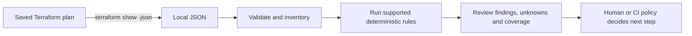

# Terraform Change Review Wiki

Terraform Change Review turns a local Terraform JSON plan into deterministic findings, selected evidence and explicit coverage information. Use the CLI in a terminal or CI, or expose the same checks to Claude Code through read-only MCP tools.

**Status:** v0.1.0, early MVP. Specialized checks cover selected Google Cloud changes. No findings is not approval to apply.

| Your goal | Start here |
|---|---|
| Install and review a first plan | [Getting started](Getting-started.md) |
| Interpret findings, unknowns and exit codes | [Reviewing plans](Reviewing-plans.md) |
| Connect Claude Code | [Claude Code and MCP](Claude-Code-and-MCP.md) |
| Understand tested coverage | [Coverage and validation](Coverage-and-validation.md) |
| Diagnose CLI, MCP or build problems | [Troubleshooting](Troubleshooting.md) |
| Develop rules or improve documentation | [Contributing](Contributing.md) |
| Find discussions, agent profiles and contributor links | [Community and project maintenance](Community.md) |

The pages in this directory are the reviewed source for the [GitHub Wiki](https://github.com/riadh-mnasri/terraform-change-review/wiki). Detailed contracts and implementation notes remain in the [main repository documentation](https://github.com/riadh-mnasri/terraform-change-review/tree/main/docs). See the [publication procedure](README.md) for how reviewed pages reach the wiki.

Keep real Terraform plans and state out of version control: JSON plans may contain plaintext secrets. The analyzer minimizes returned values and follows sensitivity masks; unmarked sensitive evidence can still be exposed.

## How a review works



The analyzer does not read live cloud state, call an LLM or approve an apply. A missing finding can mean a rule did not apply, inputs were unknown, or the resource has no specialized rule. Always inspect check outcomes and limitations.

## A safe first run

Start with a committed synthetic example before using any real infrastructure plan:

```sh
./gradlew --no-daemon clean build
java -jar build/libs/terraform-change-review.jar \
  review examples/gcp-risky.json --format markdown --fail-on none
```

The example intentionally includes several risky-looking changes. It is designed to demonstrate the report, not to represent a recommended cloud configuration. See [getting started](Getting-started.md) for a real local workflow and [review interpretation](Reviewing-plans.md) for how to read the output.
